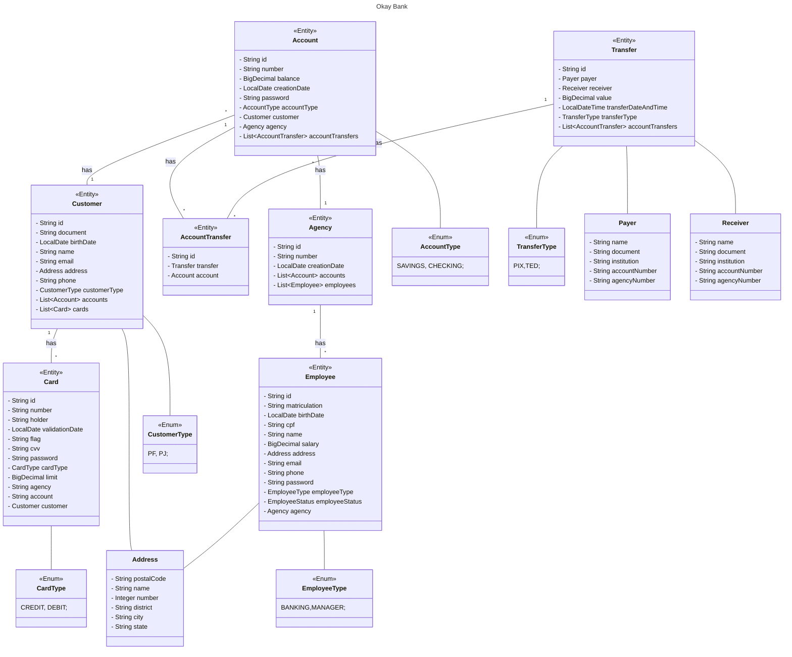

# Okay Bank

## Sobre

Aplicação do banco Okay Bank com registro de funcionários, agencias, contas, cartões, trasações e clientes.   

## Modelo

# Recursos do projeto

## Frontend

- Angular
- TypeScript

## Backend

- Spring Boot
- Java
- PostgreeSQL
- H2DB
- Arquitetura Limpa

## Funcionalidade

- Registrar agência
- Atualizar agência pelo id
- Procurar agência pelo id
- Listar agências
- Deletar agência pelo id

